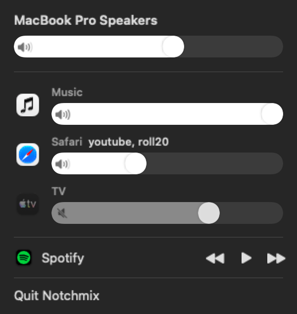

# Notchmix

A menu bar volume mixer for macOS. Every app that is playing audio gets its own volume slider and mute button.



*The picture is rendered offscreen with sample data, so it shows the layout but not the system's glass background.*

## What it does

- A permanent **System Sounds** slider and mute toggle to silence or lower macOS notification and alert sounds while still receiving visual notifications.
- One slider, live peak level meter, and mute toggle per app that is playing audio. Click an app's icon or the speaker glyph to mute it; drag or scroll over a slider to change its level.
- Per-app output device routing via each app row's route menu or context menu.
- A master slider and output device switcher for the current output device.
- For Safari and Chromium/Opera browsers, the row names the sites that are playing, for example "Safari  youtube, roll20".
- While Spotify or Apple Music is running: previous, play/pause and next.
- A one-click **Start at Login** toggle in the menu.

That is the whole feature list. There is no equaliser and no settings window.

## Requirements

- macOS 26 or later
- Apple Silicon
- To build: Xcode 26 or later (Swift 6)

## Install

Download `Notchmix-1.0.3.zip` from [Releases](https://github.com/GirlFromTheBay/Notchmix/releases), unzip it, and move `Notchmix.app` to `/Applications/`.

### Build from source

```bash
git clone https://github.com/GirlFromTheBay/Notchmix.git
cd Notchmix
./build.sh --test
cp -R ./dist/Notchmix.app /Applications/
```

`build.sh` runs the unit tests, compiles a release build, assembles and signs `dist/Notchmix.app`, and then checks the result: bundle size, that it links only against system libraries, that no build-machine paths ended up in it, and that the signature verifies. Everything it writes stays inside the project folder.

### Signing

`build.sh` signs with a Developer ID or Apple Development identity if your keychain has one, and ad-hoc otherwise. With an ad-hoc signature macOS ties the permissions below to that exact build, so they survive relaunches but are asked for again after you rebuild.

A copy of the app that was downloaded rather than built locally is neither notarised nor signed with a Developer ID, so Gatekeeper will refuse to open it at first. Allow it under System Settings → Privacy & Security → Open Anyway, or clear the quarantine attribute in Terminal:

```bash
xattr -cr /Applications/Notchmix.app
```

## Permissions

macOS asks for each of these the first time it is needed, not at launch.

| Prompt | When | Why |
| --- | --- | --- |
| System Audio Recording | The first time you lower or mute an app | The volume change is applied by reading that app's audio and playing it back at the level you chose. Nothing is recorded, stored or sent anywhere. |
| Control Safari, Chrome, Edge, Brave, Opera and others | The first time the panel is open while that browser plays audio | To ask the browser for its tabs' addresses, so the row can name the sites. Only the site's name is shown. Private windows are included. |
| Control Spotify or Music | The first time you press a transport button | To send play, pause and skip. |
| Microphone | Only if your output device also has an input, such as a headset, and macOS decides to ask | The device's input is part of the same audio device. Notchmix tells Core Audio not to open it and never reads it. |

Declining any of them leaves the rest working. Without System Audio Recording the sliders have no effect and apps play at their normal volume.

Notchmix makes no network connections.

## How it works

Volume is applied with Core Audio process taps, which need no audio driver and no administrator rights.

- An app left at 100% is never touched. Its audio takes the normal path.
- When you lower or mute an app, Notchmix creates a tap on that app's processes that mutes them at the source, joins the tap to the output device in a private aggregate device, and copies the audio across with the gain applied.
- The copying happens in a real-time callback written in C. It takes no locks and allocates nothing, and changes of level are ramped over 10 ms so they do not click.
- If Notchmix quits or crashes, macOS removes its taps and every app is audible again at full volume. The one thing that stays behind is the System Sounds alert volume while you are overriding it; Notchmix remembers your original value and puts it back the next time it starts.

Helper processes are grouped under the app they belong to, so a browser or an Electron app appears once.

## Limits

- **One slider per browser, not per tab.** Safari plays all of its tabs through a single audio process, so their audio is already mixed when it reaches Core Audio. Notchmix can name the sites that are playing but cannot give them separate volumes.
- Site names are shown for Safari and Chromium-based browsers. A site playing inside an embedded frame may not be named.
- An app you have lowered or muted keeps the output device active for as long as that app is running, even while it is silent. This is what stops the start of a sound from leaking through at full volume.
- Sliders go from silent to the app's own level. There is no boost above 100%.

## Project layout

| Path | Contents |
| --- | --- |
| `Sources/CAudioRender` | The real-time render callback, in C11 |
| `Sources/NotchmixCore` | Process discovery, tap sessions, output device handling, permission checks, browser and media-player Apple Events |
| `Sources/NotchmixUI` | The status item, the popover and the SwiftUI panel |
| `Sources/Notchmix` | The app's entry point |
| `Sources/NotchmixProbe` | A developer tool, not part of the app: lists what discovery sees and renders the panel to a PNG |
| `Tests/NotchmixTests` | Unit tests |

The app uses only Apple frameworks. There are no third-party dependencies.

### Private interfaces

Three small pieces use interfaces Apple does not document, each looked up at runtime and skipped if missing. They also mean the app cannot be sold through the Mac App Store.

- `TCCAccessPreflight` and `TCCAccessRequest` (`AudioCapturePermission.swift`): to read the System Audio Recording state without triggering the prompt.
- `responsibility_get_pid_responsible_for_pid` (`AppIdentity.swift`): to tie helper processes such as Safari's WebKit GPU process back to their app.
- The popover's `shouldHideAnchor` key (`MenuBarController.swift`): to hide the arrow. Cosmetic only.

## Contributing and security

See [CONTRIBUTING.md](CONTRIBUTING.md) and the [code of conduct](CODE_OF_CONDUCT.md). To report a vulnerability, follow [SECURITY.md](SECURITY.md) rather than opening a public issue.

## License

[MIT](LICENSE)
